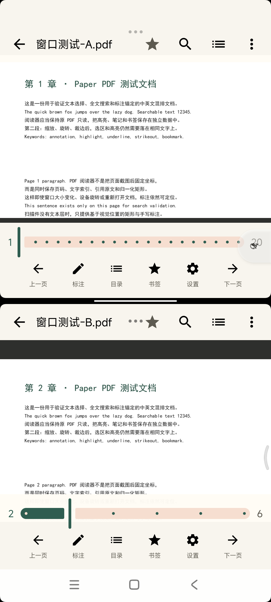

# 动机
我是一名数学系本科生，经常会用到无纸化办公的场景：读文献、查资料、看课本等等，于是非常渴求一款简洁、高效、轻巧的pdf阅读器。

但不幸的是，市面上基本所有的pdf阅读器都非常的臃肿：要么是商业化集成之后，体量非常，一个pdf阅读器非要继承云端、识别、编辑等功能，就连最基础的做标记、高亮等功能都要收费。我感到非常恼火。

爆发点是我在学习筹备ai4math平台时，由于要在电子书上做标记，但是我原先使用的那款，它的标记功能要premium，解锁要20刀。实在忍无可忍之下，开始了这个项目的开发。借着deepseek v1-flash-1021版本的更新，我在codex中完成了这款阅读器的开发，至少我用起来非常顺手。

同样的软件我发给我老师、同学和同好，他们反映都还不错，这也给了我极大的认可。

这款阅读器只有21M是我没想到的，体量这么小，希望能帮助大家更好地阅读学习，大家也可以把提交issue，集思广益。

# 纸间 PDF

**面向 Android 的本地优先 PDF 阅读与标注工具。**
一款面向安卓的功能完善的pdf阅读器

纸间 PDF 将阅读、检索、标注、书签与导出集中在同一个 Android 应用中。它支持为每份 PDF 创建独立系统窗口，可将两份文档并排放在分屏里阅读；原 PDF 默认只读，阅读进度和标注保存在本机 SQLite 数据库中。

  

  两份 PDF 分别运行在独立窗口中，页码、缩放与阅读位置互不影响。

## 功能

* **本地优先**：应用不声明网络权限，不上传文档，也不依赖云端账号。
* **真正独立的多文档窗口**：每份 PDF 对应独立的 Android 阅读任务，可使用系统分屏或自由窗口。
* **不只“能看”**：支持全文搜索、目录、书签、缩略图、长按选词、高亮、笔记和手写。
* **标注可迁移**：可导出 JSON、Markdown 笔记，或生成带标准 PDF 批注的新副本。
* **手机阅读优先**：支持纵向连续滚动、横向翻页、双击缩放、双指缩放和阅读进度恢复。

## 功能概览

| 阅读  | 标注  | 文档管理 |
| --- | --- | --- |
| 纵向滚动 / 横向翻页 | 高亮、下划线、删除线 | 历史文档与手机文件 |
| 双击缩放 / 双指缩放 | 文本笔记、文本框 | SAF 文件夹扫描 |
| 页面旋转 / 平板整页适配 | 画笔、橡皮擦、撤销 / 重做 | 全文扫描可选“所有文件访问” |
| 目录与页面缩略图 | 点按标注后编辑或删除 | 扫描结果本地缓存 |
| 全文搜索与关键词定位 | 单指书写、双指移动页面 | 已读 / 未读状态管理 |
| 阅读位置与缩放恢复 | 书签添加、重命名和跳转 | PDF 系统分享 |

### 独立多文档窗口

从文档库打开 PDF 时，应用会为当前文档创建独立阅读窗口。再次打开另一份 PDF 会创建新的系统任务，因此可以：

* 在最近任务中找到每个 PDF 的独立卡片；
* 在支持分屏的设备上同时查看两份文档；
* 分别控制两个窗口的页码、缩放和滚动位置；
* 关闭一个窗口而不影响其他正在阅读的文档；
* 从文件管理器、浏览器或其他应用直接打开 PDF。

### 面向长文档的阅读体验

* 按视口优先渲染当前页，并为后续页面预留预览缓存，减少连续滚动时的空白和闪烁；
* 纵向连续阅读与横向单页阅读可随时切换；
* 平板横屏时按整页显示，双击在“整页”和“适宽”之间切换；
* 退出后可恢复上次阅读页、页内位置和缩放比例；
* 支持密码 PDF，密码仅在当前阅读会话内使用。

### 阅读与知识整理

* 内嵌目录跳转；
* 跨页全文搜索并显示文本命中上下文；
* 页面缩略图快速定位；
* 可重命名书签；
* 长按选中中文或英文文本，添加高亮、下划线、删除线或笔记；
* 手写标注与文本锚点分开保存，缩放或重新打开文档后仍可定位；
* 标注支持编辑、删除、撤销和重做。

### 导出与分享

阅读页右上角菜单和文档库均支持分享原 PDF。标注数据可以导出为：

| 格式  | 用途  |
| --- | --- |
| 带批注 PDF | 生成包含高亮、笔记和手写内容的新 PDF 副本 |
| JSON | 备份文档指纹、阅读位置、书签、标注与文本锚点 |
| Markdown | 按页整理引用原文、笔记和标签，便于导入笔记软件 |

原 PDF 始终保持只读，任何导出都会创建新文件。

## 安装

### 系统要求

| 项目  | 要求  |
| --- | --- |
| Android | 8.0（API 26）及以上 |
| 目标版本 | Android 16（API 36） |
| 处理器架构 | `arm64-v8a` |
| 当前版本 | 0.4.0（versionCode 7） |

请前往本仓库的 **Releases** 页面下载最新 APK。

> 如果设备上安装过签名不同的旧版本，首次切换正式签名包时可能需要先卸载旧版本。卸载会清除应用数据库，请先备份需要保留的标注和书签。

## 技术实现

| 模块  | 实现  |
| --- | --- |
| UI  | Kotlin、Jetpack Compose、Material 3 |
| 阅读画布 | 自绘 `PdfReaderView` |
| PDF 渲染 | PDFium（`io.legere:pdfiumandroid:2.0.1`） |
| 批注导出 | PDFBox-Android（`2.0.27.0`） |
| 本地数据 | Android SQLite（`ReaderDb`） |
| 多窗口 | 独立 `ReaderActivity` + Android document task |
| 自动发布 | GitHub Actions |

主要源码目录：

    app/src/main/java/com/paperpdf/reader/
    ├── data/      # 文档扫描、SQLite、设置和分享
    ├── engine/    # PDFium 渲染与文本层适配
    ├── export/    # PDF、JSON、Markdown 导出
    └── ui/        # 文档库、阅读页、阅读画布和 ViewModel

## 隐私与数据

* 当前版本未声明 `INTERNET` 权限，文档不会由应用主动上传。
* 文档、阅读进度、书签和标注保存在本机应用数据库中。
* 密码 PDF 的密码只用于当前阅读会话，不写入文档数据库。
* “所有文件访问”仅用于遍历设备中的 PDF 列表；应用不会修改或删除其他文件。
* 若不愿授予全盘权限，可使用 SAF 只授权一个文件夹。
* 应用不会默认启用 OCR 或 AI 服务。
* 是否进入 Android 系统级备份取决于设备与系统设置。

## 已知限制

* 当前 APK 仅包含 `arm64-v8a` 原生库。
* 扫描版 PDF 没有文本层时，只能进行页面渲染和视觉标注，不支持选词、文本搜索或 OCR。
* 当前版本不包含 OCR、AI 摘要、云同步或在线翻译。
* 全文搜索依赖 PDF 自带文本层；复杂排版或特殊编码 PDF 的检索结果可能不完整。
* 独立窗口是否可用，以及是否支持自由窗口，取决于设备系统和厂商实现；标准手机可使用系统分屏。
* 历史记录引用原文件地址。文件被移动或删除后，需要重新从设备中选择。

## 项目状态

纸间 PDF 目前以个人维护为主，重点是把本地 PDF 阅读、标注和多文档对照做稳。遇到问题时，可在本仓库提交 Issue，并附上 Android 版本、设备型号、复现步骤和必要的日志或截图。

## 第三方组件与许可证

项目使用 PDFium Android 和 PDFBox-Android 完成渲染与标准批注导出，相关组件分别遵循其自身许可证。公开分发源码或 APK 前，应补齐应用代码的 `LICENSE`、`THIRD_PARTY_NOTICES.md`，并保留第三方版权与许可声明。

当前源码包尚未附带独立的应用代码许可证；在许可证正式确定前，请勿将项目视为已按某个开源许可证授权。
